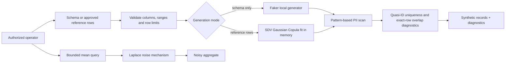

# High-Fidelity Synthetic Data Generation & Differential Privacy Engine

A local API for schema-driven synthetic records, optional SDV Gaussian Copula fitting on operator-supplied reference rows, PII-pattern diagnostics, and an illustrative Laplace noisy-mean endpoint.

## Workflow



## Quick start

```sh
python3 -m venv .venv
source .venv/bin/activate
python -m pip install -r requirements.txt
uvicorn app.main:app --reload --port 8000
```

- `POST /v1/generate`: generate records from typed column specifications without reading a private dataset.
- `POST /v1/fit-generate`: fit SDV `GaussianCopulaSynthesizer` in memory from 20–5,000 operator-supplied rows, sample output, then return diagnostics. Input rows are not persisted.
- `POST /v1/generate-text`: optionally call a configured OpenAI-compatible model to generate fictional schema-valid objects, then scan candidate PII patterns. No reference dataset is sent by this endpoint.
- `POST /v1/privacy/noisy-mean`: clamp values to caller-supplied bounds and release a Laplace-noised mean using caller-supplied epsilon.

An example schema is in [`data/schema.example.json`](data/schema.example.json). To enable Presidio scanning, set `PRESIDIO_ENABLED=true` and install/configure a supported Presidio NLP engine; the compose image does not download a language model. To enable text generation, set `SYNTHETIC_LLM_URL`, `SYNTHETIC_LLM_MODEL`, and optionally `SYNTHETIC_LLM_API_KEY`. The API is unauthenticated and bound to localhost in the provided compose file.

## Privacy interpretation

Pattern scanning detects only email, SSN-shaped, and payment-card-shaped strings. It can miss sensitive values and flag synthetic placeholders. Uniqueness and overlap checks are diagnostics only. The standard SDV Gaussian Copula synthesizer used here does **not** provide differential privacy.

The noisy-mean endpoint demonstrates one bounded query mechanism; it does not maintain a privacy budget, account for repeated releases, authenticate callers, or protect against a caller choosing inappropriate bounds. Repeated calls can compose privacy loss. Do not describe the service as providing end-to-end differential privacy without a reviewed accountant, release policy, and privacy analysis.

See [architecture](docs/ARCHITECTURE.md), [data and privacy](docs/DATA_AND_PRIVACY.md), [deployment](docs/DEPLOYMENT.md), and [development](docs/DEVELOPMENT.md).
