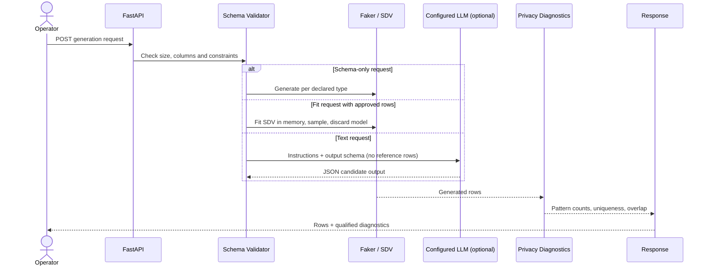

# Architecture

## Components

- **Schema API** validates supported column kinds, bounds, and category declarations. The local Faker path creates synthetic data without loading source data.
- **SDV adapter** accepts bounded caller-supplied reference rows, detects single-table metadata, fits `GaussianCopulaSynthesizer`, samples the requested rows, and releases the fitted object after the request.
- **LLM text generator** optionally sends generation instructions and a JSON Schema to a configured OpenAI-compatible endpoint. It validates JSON and each generated object against the supplied schema before returning it.
- **Privacy diagnostics** scan generated values for a small set of PII-shaped patterns and calculate optional quasi-identifier uniqueness and exact row overlap.
- **Noisy mean** clamps the input values to declared bounds and adds Laplace noise using sensitivity `(upper_bound - lower_bound) / n` and scale `sensitivity / epsilon`.

## Boundaries

The SDV request does not persist rows or models. It is synchronous and can use substantial CPU and memory; enforce request limits and worker limits at deployment. The privacy metrics do not establish a formal privacy guarantee. LLM generation is optional and requires a configured provider; Presidio scanning is opt-in and requires a configured NLP model. The project does not implement a production privacy accountant.
